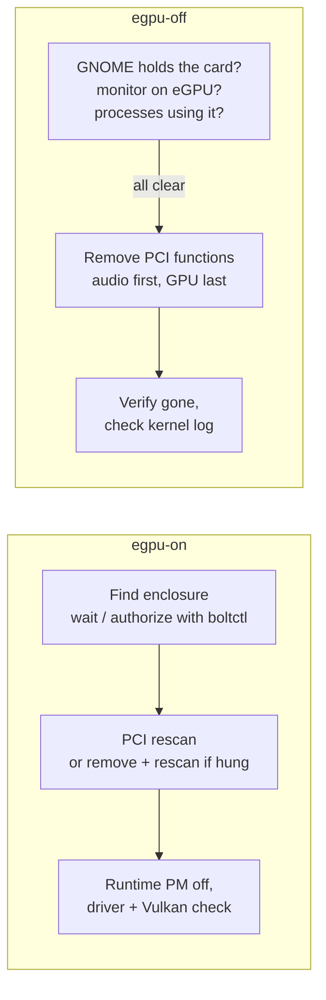

# egpu-tools

Safely connect and disconnect a **Thunderbolt / USB4 eGPU on Linux** without rebooting.

`egpu-on` brings the eGPU online and verifies it. `egpu-off` checks that nothing is using it, then detaches it so you can power off or unplug the enclosure while the PC keeps running. Two udev rules work around problems seen in practice:

| Problem | Fix |
|---|---|
| The GPU hangs when it wakes from runtime suspend over USB4 (`ring gfx test failed (-110)`), and Vulkan loses it | `80-egpu-no-runpm.rules` keeps runtime PM off for eGPUs. `egpu-on` recovers a hung card with a PCI remove + rescan |
| GNOME Shell crashes minutes after an eGPU is hot-removed, logging you out ([mutter#4705](https://gitlab.gnome.org/GNOME/mutter/-/issues/4705)) | `81-egpu-mutter-ignore.rules` stops GNOME from managing the eGPU's display device. Both scripts refuse risky steps while GNOME holds the card |
| Pulling the cable while apps use the GPU crashes them or hangs the driver | `egpu-off` lists every process holding the eGPU and refuses until they're gone |

Built and tested on a Razer Core X V2 with an RX 7900 XTX on Ubuntu 26.04 / GNOME 50. The scripts detect the eGPU on their own, so other enclosures and GPUs should work too (see [Compatibility](#compatibility)).

## Install

```bash
curl -fsSL https://raw.githubusercontent.com/jacob-huang/egpu-tools/main/install.sh | bash
```

The installer downloads this repository, installs the scripts to `/usr/local`, installs the udev rules, and asks for your sudo password when it needs it. Prefer to read it first?

```bash
curl -fsSLO https://raw.githubusercontent.com/jacob-huang/egpu-tools/main/install.sh
less install.sh
bash install.sh
```

Or from a clone: `git clone https://github.com/jacob-huang/egpu-tools && cd egpu-tools && ./install.sh`.

**After installing, reconnect the eGPU once while logged out of GNOME** (on the login screen press Ctrl+Alt+F3, log in, run `egpu-on`). The udev rules apply when the card appears, so a card that's already connected keeps its old state until then.

| Option | Effect |
|---|---|
| `--user` | Install the scripts to `~/.local` (the udev rules still need sudo) |
| `--prefix DIR` | Install the scripts under `DIR` |
| `--no-mutter-ignore` | Skip the GNOME rule. Use this if you plug monitors into the eGPU's own outputs |
| `--no-runpm-rule` | Skip the runtime-PM rule |
| `--no-udev` | Skip both rules |
| `--install-deps` | Install missing packages with apt, dnf, pacman or zypper |
| `--ref TAG` | Install a specific branch or tag (one-liner) |
| `-n`, `--dry-run` | Show what would be done |
| `--link` | Symlink to a checkout instead of copying (development) |

Pass options to the one-liner with `bash -s --`, for example `curl -fsSL …/install.sh | bash -s -- --no-mutter-ignore`.

**Uninstall:** `curl -fsSL …/install.sh | bash -s -- --uninstall` (add `--purge` to also remove `/etc/egpu-tools.conf`).

**Dependencies:** `bash` 4+, `lspci` (pciutils), `fuser` (psmisc), and systemd's `udevadm`, `loginctl` and `journalctl`. Optional: `boltctl` (bolt) to authorize a new enclosure, and `vulkaninfo` (vulkan-tools) for the Vulkan check. The installer lists anything missing.

## Use

```bash
egpu-on                # power on the enclosure, plug it in, then run this (or run it first; it waits)
egpu-off --dry-run     # check whether it's safe to detach, change nothing
egpu-off               # detach; then power off / unplug the enclosure
```

Typical `egpu-on` result:

```
OK  eGPU online.
     PCI      : 0000:08:00.0  [1002:744c] Navi 31 [Radeon RX 7900 XT/7900 XTX/7900 GRE/7900M]
     Driver   : amdgpu
     Vulkan   : AMD Radeon RX 7900 XTX (RADV NAVI31)
     Link     : 20.0 Gb/s x2 rx / 20.0 Gb/s x2 tx
     GNOME    : ignored by GNOME (mutter-device-ignore) - egpu-off works while logged in
     Use it   : DRI_PRIME=1 <app>   |   MESA_VK_DEVICE_SELECT=1002:744c! <app>
```

Both scripts ask for your password once (they re-run themselves with `sudo`), and `--help` shows every option and exit code. The [runbook](docs/RUNBOOK.md) covers the full procedures, power-on order, troubleshooting (T1–T9), and LLM-inference and gaming setups.

**Tip:** Electron apps (VS Code and others) and GTK 4 apps (such as the Ptyxis terminal) open every GPU when they start. Start them before `egpu-on`, or quit them before `egpu-off`. `egpu-off` points this out when it happens.

## Configuration

Nothing is required. By default the eGPU is the first display device the kernel marks *removable* (it sits behind a Thunderbolt/USB4 port), and the enclosure is the first Thunderbolt/USB4 device. If you have more than one of either, such as an eGPU plus a Thunderbolt dock, set them in `/etc/egpu-tools.conf`:

```ini
EGPU_PCI_ID=1002:744c        # from: lspci -nn
EGPU_TB_NAME=Core X V2       # from: boltctl list
```

The file also holds timeouts and extra processes allowed to hold the eGPU during a detach. The file is parsed, not executed.

## Compatibility

| | Status |
|---|---|
| Razer Core X V2 + AMD RX 7900 XTX, USB4 40 Gb/s, Ubuntu 26.04, GNOME 50 Wayland | Tested |
| Other Thunderbolt 3/4/5 or USB4 enclosures, other AMD GPUs | Expected to work |
| NVIDIA (proprietary driver) | Detection and `/dev/nvidiaN` checks are implemented but untested |
| KDE Plasma, other desktops | The scripts work; the GNOME-specific checks just pass. Hot-remove behavior of other compositors is untested |

The udev rules use the PCI `removable` attribute, which recent kernels set for devices behind Thunderbolt/USB4 ports. Check yours with `cat /sys/bus/pci/devices/<eGPU address>/removable` (should print `removable`). If it doesn't, set `EGPU_PCI_ID` in the config and adapt the rules to match your vendor and device ID.

## How it works



Exit codes are stable, so you can script around them: `egpu-on` returns 0 online, 2 enclosure not detected, 3 GPU unhealthy, 4 aborted, 5 blocked by the GNOME session check. `egpu-off` returns 0 detached, 2 blocked, 3 removal failed (don't power off), 4 aborted.

## Development

```
bin/                 egpu-on, egpu-off
lib/egpu-tools/      common.sh, shared detection and session helpers
udev/                80-egpu-no-runpm.rules, 81-egpu-mutter-ignore.rules
etc/                 egpu-tools.conf, the default config
docs/RUNBOOK.md      operations runbook for the reference setup
install.sh           installer and uninstaller
tests/run.sh         offline tests (no eGPU, root or sudo needed)
```

```bash
tests/run.sh                      # syntax, ShellCheck, CLI, config parser, detection, installer
./install.sh --user --link        # use the scripts straight from your checkout
```

Run the scripts from the checkout with `bin/egpu-off --dry-run`. Real attach and detach runs need the hardware. CI runs `tests/run.sh` on every push.
