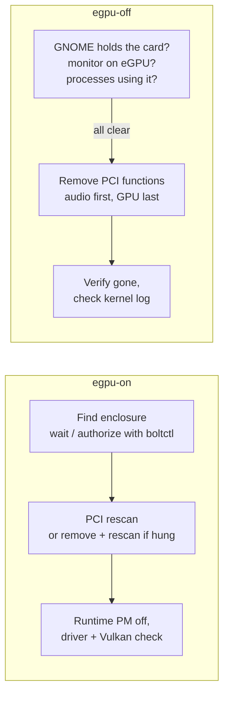

# egpu-tools

Safely connect and disconnect a **Thunderbolt / USB4 eGPU on Linux** without rebooting.

## What it does

Linux supports hot-plugging an eGPU, but doing it by hand is fragile: the GPU can hang after waking from power saving, apps crash if the cable is pulled while they use it, and GNOME can crash minutes after a card it manages disappears. egpu-tools wraps the safe procedure in two commands:

- **`egpu-on`** brings the eGPU online from any starting state (enclosure off, just plugged in, detached earlier, or hung) and verifies the driver, Vulkan and the link.
- **`egpu-off`** checks that nothing is using the eGPU, then detaches it so you can power off or unplug the enclosure while the PC keeps running.

Two udev rules work around problems seen in practice:

| Problem | Fix |
|---|---|
| The GPU hangs when it wakes from runtime suspend over USB4 (`ring gfx test failed (-110)`), and Vulkan loses it | `80-egpu-no-runpm.rules` keeps runtime PM off for eGPUs. `egpu-on` recovers a hung card with a PCI remove + rescan |
| GNOME Shell crashes minutes after an eGPU is hot-removed, logging you out ([mutter#4705](https://gitlab.gnome.org/GNOME/mutter/-/issues/4705)) | `81-egpu-mutter-ignore.rules` stops GNOME from managing the eGPU's display device. Both scripts refuse risky steps while GNOME holds the card |
| Pulling the cable while apps use the GPU crashes them or hangs the driver | `egpu-off` lists every process holding the eGPU and refuses until they're gone |

Built and tested on a Razer Core X V2 with an RX 7900 XTX on Ubuntu 26.04 / GNOME 50. The scripts detect the eGPU on their own, so other enclosures and GPUs should work too (see [Compatibility](#compatibility)).

## Install

```bash
curl -fsSL https://raw.githubusercontent.com/jacob-huang/egpu-tools/main/install.sh | bash
```

The installer downloads this repository, installs the scripts to `/usr/local`, installs the udev rules, and asks for your sudo password when it needs it. Prefer to read it first?

```bash
curl -fsSLO https://raw.githubusercontent.com/jacob-huang/egpu-tools/main/install.sh
less install.sh
bash install.sh
```

Or from a clone: `git clone https://github.com/jacob-huang/egpu-tools && cd egpu-tools && ./install.sh`.

**After installing, reconnect the eGPU once while logged out of GNOME** (on the login screen press Ctrl+Alt+F3, log in, run `egpu-on`), or reboot with the enclosure powered on. The udev rules apply when the card appears, so a card that's already connected keeps its old state until then.

| Option | Effect |
|---|---|
| `--user` | Install the scripts to `~/.local` (the udev rules still need sudo) |
| `--prefix DIR` | Install the scripts under `DIR` |
| `--no-mutter-ignore` | Skip the GNOME rule. Use this if you plug monitors into the eGPU's own outputs |
| `--no-runpm-rule` | Skip the runtime-PM rule |
| `--no-udev` | Skip both rules |
| `--install-deps` | Install missing packages with apt, dnf, pacman or zypper |
| `--ref TAG` | Install a specific branch or tag (one-liner) |
| `-n`, `--dry-run` | Show what would be done |
| `--link` | Symlink to a checkout instead of copying (development) |

Pass options to the one-liner with `bash -s --`, for example `curl -fsSL …/install.sh | bash -s -- --no-mutter-ignore`.

**Uninstall:** `curl -fsSL …/install.sh | bash -s -- --uninstall` (add `--purge` to also remove `/etc/egpu-tools.conf`).

**Dependencies:** `bash` 4+, `lspci` (pciutils), `fuser` (psmisc), and systemd's `udevadm`, `loginctl` and `journalctl`. Optional: `boltctl` (bolt) to authorize a new enclosure, and `vulkaninfo` (vulkan-tools) for the Vulkan check. The installer lists anything missing.

## User guide

Both commands ask for your password once (they re-run themselves with `sudo`). The [runbook](docs/RUNBOOK.md) has the full procedures behind each step.

**Golden rule: the enclosure powers on first and powers off last.** The GPU must never lose power, or lose its cable, while the PC is using it.

### Connect the eGPU (PC already running)

1. **Start your desktop apps first.** Electron apps (VS Code and others) and GTK 4 apps (such as the Ptyxis terminal) open every GPU when they start, and an app holding the eGPU blocks `egpu-off` later. Apps started before the eGPU appears never see it.
2. **Power on the enclosure** and wait about 5–10 s for it to settle.
3. **Plug the USB4 cable** into the PC's USB4 / Thunderbolt port. Use a certified USB4 40 Gb/s, TB4 or TB5 cable; a plain USB-C cable won't carry PCIe.
4. **Run `egpu-on`.** You can also run it before steps 2–3: it waits up to 120 s (`--wait SECS`) for the enclosure. The first time, it authorizes the enclosure with `boltctl`.
5. **Check the summary.** A typical result:

   ```
   OK  eGPU online.
        PCI      : 0000:08:00.0  [1002:744c] Navi 31 [Radeon RX 7900 XT/7900 XTX/7900 GRE/7900M]
        Driver   : amdgpu
        Vulkan   : AMD Radeon RX 7900 XTX (RADV NAVI31)
        Link     : 20.0 Gb/s x2 rx / 20.0 Gb/s x2 tx
        GNOME    : ignored by GNOME (mutter-device-ignore) - egpu-off works while logged in
        Use it   : DRI_PRIME=1 <app>   |   MESA_VK_DEVICE_SELECT=1002:744c! <app>
   ```

   The **GNOME** line tells you whether you can detach later without logging out. `egpu-on` refuses (exit `5`) to attach while you're logged in to GNOME if the GNOME rule isn't installed, since you'd have to log out to detach it again.

### Use the eGPU

GNOME keeps drawing the desktop on the internal GPU, so apps run there unless you choose the eGPU:

| How | Command |
|---|---|
| Any app (OpenGL + Vulkan) | `DRI_PRIME=1 <app>` |
| Vulkan only, strict | `MESA_VK_DEVICE_SELECT=<vendor:device>! <app>` (the ID from `egpu-on`) |
| Steam game | Launch options: `DRI_PRIME=1 %command%` |
| GNOME launcher | Right-click the app → *Launch using Discrete Graphics Card* |

The runbook covers [LLM inference](docs/RUNBOOK.md#use-case-a-llm-inference-headless-compute) and [gaming setups](docs/RUNBOOK.md#use-case-b-gaming), including monitors plugged into the eGPU.

### Disconnect the eGPU (PC stays on)

1. **Save your work and quit apps using the eGPU**: games, LLM servers, and Electron / GTK 4 apps started after `egpu-on`. Quit them completely (for Ptyxis, close every window); reopen them after the detach.
2. **Check:** `egpu-off --dry-run` runs every check and changes nothing. It lists anything blocking the detach.
   - **"Safe to detach without logging out"**: stay logged in.
   - **GNOME manages the eGPU**: save your work, log out, press Ctrl+Alt+F3 on the login screen, log in on the text console and continue there.
   - If your terminal itself holds the eGPU (Ptyxis does), use a text console (Ctrl+Alt+F3) or SSH.
3. **Detach:** `egpu-off`. It asks for confirmation (`-y` skips it), removes the GPU from the PCI bus, and tells you when it's safe.
4. **Unplug the USB4 cable.**
5. **Power off the enclosure.**

Changed your mind before unplugging? Run `egpu-on` and the GPU comes back without touching the cable.

**Never power off or unplug the enclosure without detaching first**, including while the PC is asleep: to the PC, that's the same as yanking the card out. If `egpu-off` exits `3` (removal failed or timed out), **don't power off**; see [T6](docs/RUNBOOK.md#t6-software-detach-hangs-or-the-gpu-comes-back-broken).

### Start up and shut down with the eGPU attached

| Situation | Order |
|---|---|
| Cold start | 1. Power on the enclosure, wait about 5 s. 2. Turn on the PC. The GPU is detected during boot. |
| Shut down | 1. Shut down the PC and wait until it's fully off. 2. Power off the enclosure. |

Don't power the enclosure on in the middle of PC boot: the GPU can come up half-initialized. On some hosts the GPU fails to initialize when booting with the enclosure already on (see [Common issues](#common-issues-and-troubleshooting)); if yours does, connect it after logging in instead.

### Command reference

```
egpu-on  [-w|--wait SECS] [-y|--yes] [--allow-graphical-session] [-V|--version] [-h|--help]
egpu-off [-n|--dry-run] [-f|--force] [--allow-graphical-session] [-y|--yes] [-V|--version] [-h|--help]
```

| Option | Command | Effect |
|---|---|---|
| `-w`, `--wait SECS` | `egpu-on` | How long to wait for the enclosure to appear (default 120) |
| `-y`, `--yes` | both | Don't ask before re-initializing a broken GPU (`egpu-on`) or before detaching (`egpu-off`) |
| `-n`, `--dry-run` | `egpu-off` | Run all checks, change nothing |
| `-f`, `--force` | `egpu-off` | Detach even if a monitor or app is using the eGPU; listed apps may crash. Does **not** override the GNOME session check |
| `--allow-graphical-session` | both | Attach, re-initialize or detach even though GNOME manages (or will manage) the eGPU. After a detach, the session may crash and log you out minutes later |
| `-V`, `--version` / `-h`, `--help` | both | Print the version / the full help with every exit code |

Exit codes are stable, so you can script around them:

| Code | `egpu-on` | `egpu-off` |
|---|---|---|
| `0` | eGPU online and healthy | Detached (or already absent) |
| `1` | Usage or environment error | Usage or environment error |
| `2` | Enclosure not detected | Blocked: GNOME manages the card in an active session, a monitor is on the eGPU, or processes are using it |
| `3` | GPU didn't come up, or is unhealthy | Removal failed or timed out; don't power off |
| `4` | Aborted by you | Aborted by you |
| `5` | Blocked: graphical session active and GNOME would manage (or already holds) the eGPU | — |

## Common issues and troubleshooting

Work through the symptom that matches. The runbook's [troubleshooting section](docs/RUNBOOK.md#6-troubleshooting) has the full checks (T1–T9) and a [diagnostics bundle](docs/RUNBOOK.md#collect-diagnostics-for-a-bug-report) for bug reports.

**`egpu-on` says the enclosure isn't detected (exit `2`)**
1. Check the enclosure is powered on: power cord, PSU switch, power LED or fans.
2. Use the PC's USB4 / Thunderbolt port; other USB-C ports may not carry PCIe.
3. Swap in a known-good USB4 40 Gb/s, TB4 or TB5 cable, ideally 0.8 m or shorter.
4. `boltctl list` should show the enclosure. If it shows `connected` but not `authorized`, run `egpu-on` again or see [T2](docs/RUNBOOK.md#t2-detected-but-not-authorized). Otherwise see [T1](docs/RUNBOOK.md#t1-enclosure-not-detected-at-all).

**`egpu-on` refuses because of the GNOME session (exit `5`)**
The GNOME rule isn't installed, so GNOME would take the card. Run `install.sh` (it installs the rule), or log out and run `egpu-on` from a text console (Ctrl+Alt+F3).

**`egpu-on` reports the GPU as unhealthy (exit `3`)**
1. A GPU that hung after waking from power saving is re-initialized for you: `egpu-on` asks, then removes and rescans it (`-y` skips the question). See [T5](docs/RUNBOOK.md#t5-runtime-pm-hang-card-dead-but-still-on-the-bus).
2. If it doesn't come back, power-cycle: run `egpu-off` if it can, unplug the cable, switch the enclosure off and on, then plug back in and run `egpu-on`. See [T6](docs/RUNBOOK.md#t6-software-detach-hangs-or-the-gpu-comes-back-broken).

**The GPU fails to initialize: `ring gfx_0.0.0 test failed (-110)`, `Fatal error during GPU init`, or `device lost from bus!` in `journalctl -k`**
Treat it as a power-delivery fault:
1. Switch the enclosure off, then unplug its AC cord and the USB4 cable.
2. Reseat every PCIe power connector on the GPU (and at the PSU, if its cables are modular).
3. Leave AC unplugged for about a minute so the PSU resets, then power on and plug the cable back in.
4. If the card still drops off the bus with every connector seated, suspect the enclosure's PSU. See [T4](docs/RUNBOOK.md#t4-gpu-present-but-amdgpu-didnt-bind).

This was also seen after booting with the enclosure on; if it happens only at boot, connect the eGPU after logging in instead. `BAR 0 ... failed to assign` lines are harmless: they only mean Resizable BAR is off.

**`egpu-off` refuses to detach (exit `2`)**
It prints the reason:
- **GNOME manages the eGPU:** log out and detach from a text console. For next time, make sure the GNOME rule is installed and reconnect the eGPU once while logged out; `egpu-off` tells you which of the two applies.
- **A monitor is connected to the eGPU:** move your windows to the host monitor, then unplug that monitor or turn it off in *Settings → Displays*.
- **Processes are using the eGPU:** quit them. Apps holding only the render node are usually Electron or GTK 4 apps started after `egpu-on`; quit them completely and reopen them after the detach. Don't use `--force` on them: their GPU process can crash.

**`egpu-off` says removal failed or timed out (exit `3`)**
Don't power off or unplug yet: a process is stuck in the driver. Look for it with `ps -eo pid,stat,comm | awk '$2 ~ /D/'`. See [T6](docs/RUNBOOK.md#t6-software-detach-hangs-or-the-gpu-comes-back-broken).

**GNOME logged you out a few minutes after a detach**
GNOME managed the card when it was removed ([mutter#4705](https://gitlab.gnome.org/GNOME/mutter/-/issues/4705)). Install the GNOME rule and reconnect the eGPU once while logged out; `egpu-on`'s **GNOME** line should then say "ignored by GNOME". See [Known risk](docs/RUNBOOK.md#known-risk-gnomemutter-crash-on-hot-remove).

**An app runs on the internal GPU instead of the eGPU**
Launch it with `DRI_PRIME=1` or `MESA_VK_DEVICE_SELECT` (see [Use the eGPU](#use-the-egpu) and [T7](docs/RUNBOOK.md#t7-app-runs-on-the-igpu-instead-of-the-egpu)).

**Performance is lower than expected**
- `boltctl list` should show `40 Gb/s = 2 lanes * 20 Gb/s`; less means a cable or port problem.
- USB4 carries about 3–4 GB/s of real PCIe traffic, so work that streams data between system RAM and the GPU is limited by the cable, and a monitor on the host's port costs a copy of every frame. Work that fits in VRAM runs close to full speed. See [T8](docs/RUNBOOK.md#t8-poor-performance).

**A monitor plugged into the eGPU stays black**
With the GNOME rule installed, GNOME doesn't drive the eGPU's own outputs. Reinstall with `--no-mutter-ignore` if you use them (you'll then need to log out before `egpu-off`). Otherwise see [T9](docs/RUNBOOK.md#t9-monitor-on-the-egpu-stays-black).

## Configuration

Nothing is required. By default the eGPU is the first display device the kernel marks *removable* (it sits behind a Thunderbolt/USB4 port), and the enclosure is the first Thunderbolt/USB4 device. If you have more than one of either, such as an eGPU plus a Thunderbolt dock, set them in `/etc/egpu-tools.conf`:

```ini
EGPU_PCI_ID=1002:744c        # from: lspci -nn
EGPU_TB_NAME=Core X V2       # from: boltctl list
```

The file also holds timeouts and extra processes allowed to hold the eGPU during a detach. The file is parsed, not executed.

## Compatibility

| | Status |
|---|---|
| Razer Core X V2 + AMD RX 7900 XTX, USB4 40 Gb/s, Ubuntu 26.04, GNOME 50 Wayland | Tested |
| Other Thunderbolt 3/4/5 or USB4 enclosures, other AMD GPUs | Expected to work |
| NVIDIA (proprietary driver) | Detection and `/dev/nvidiaN` checks are implemented but untested |
| KDE Plasma, other desktops | The scripts work; the GNOME-specific checks just pass. Hot-remove behavior of other compositors is untested |

The udev rules use the PCI `removable` attribute, which recent kernels set for devices behind Thunderbolt/USB4 ports. Check yours with `cat /sys/bus/pci/devices/<eGPU address>/removable` (should print `removable`). If it doesn't, set `EGPU_PCI_ID` in the config and adapt the rules to match your vendor and device ID.

## How it works



## Development

```
bin/                 egpu-on, egpu-off
lib/egpu-tools/      common.sh, shared detection and session helpers
udev/                80-egpu-no-runpm.rules, 81-egpu-mutter-ignore.rules
etc/                 egpu-tools.conf, the default config
docs/RUNBOOK.md      operations runbook for the reference setup
docs/reference-benchmarks.md  measured results per host, compare with tools/egpu-bench
install.sh           installer and uninstaller
tests/run.sh         offline tests (no eGPU, root or sudo needed)
tools/egpu-bench     benchmark + power log (read-only, run from a clone)
LICENSE              MIT
```

```bash
tests/run.sh                      # syntax, ShellCheck, CLI, config parser, detection, installer
./install.sh --user --link        # use the scripts straight from your checkout
```

Run the scripts from the checkout with `bin/egpu-off --dry-run`. Real attach and detach runs need the hardware. CI runs `tests/run.sh` on every push.

## License

[MIT](LICENSE)
