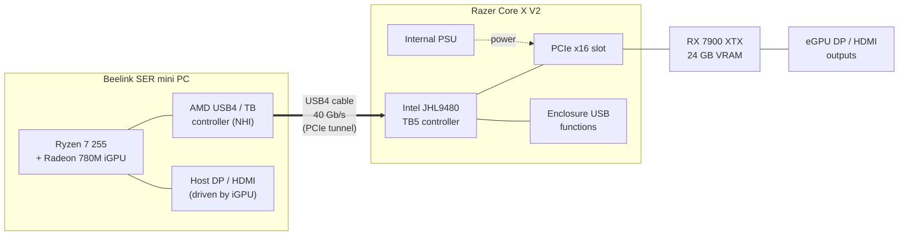
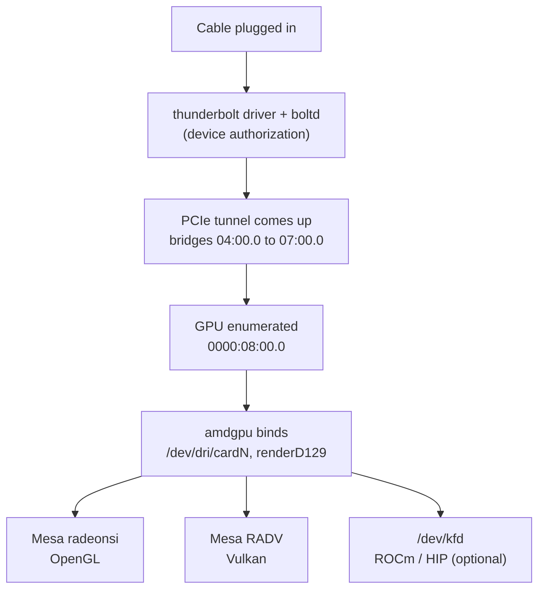
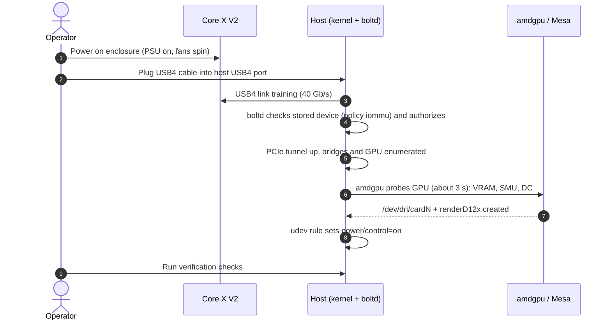
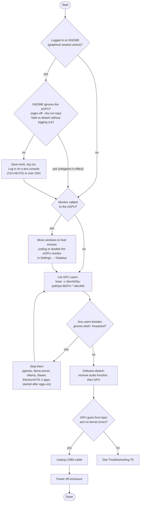
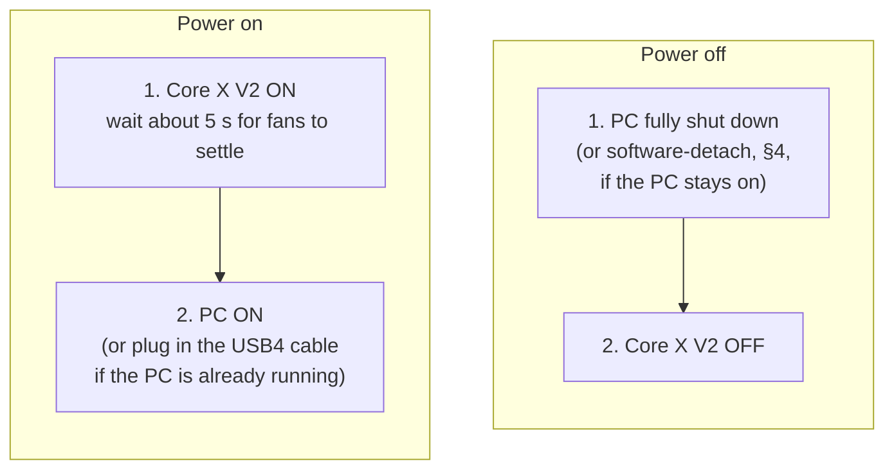
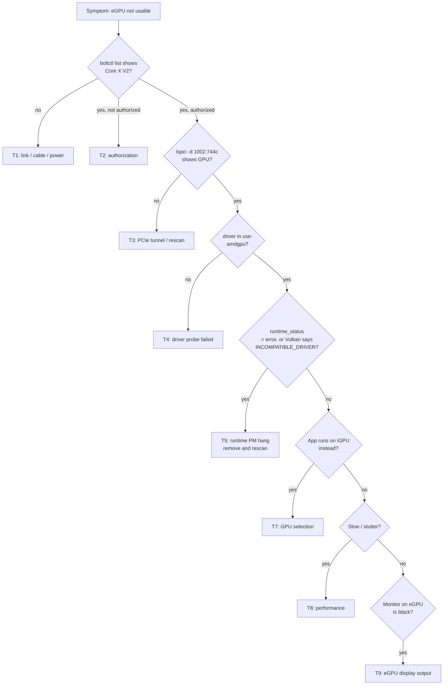
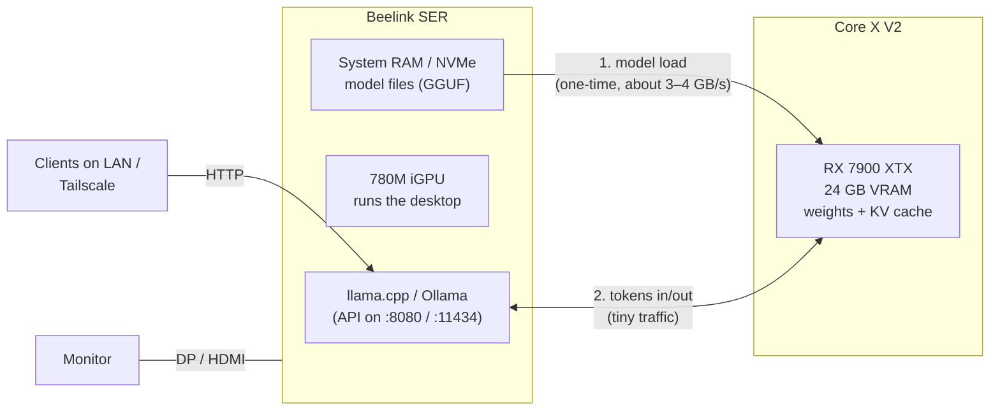
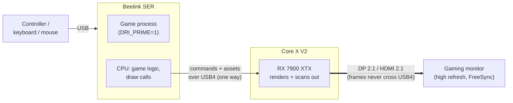
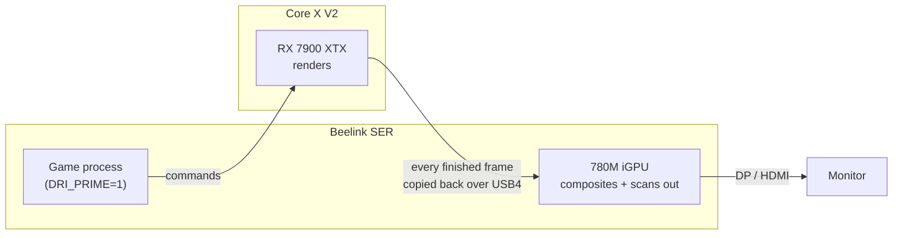
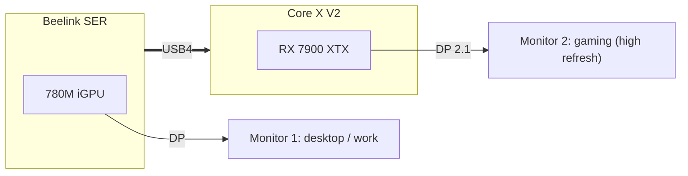

# Razer Core X V2 eGPU Runbook

Operational runbook for the **Razer Core X V2** enclosure with a **Sapphire NITRO+ RX 7900 XTX Vapor-X** (24 GB), attached over **USB4** to a Beelink SER mini PC. This is the reference setup that egpu-tools was built and tested on.

> **Using different hardware?** The procedures apply to any Thunderbolt/USB4 eGPU on Linux. Where the manual commands use the PCI ID `1002:744c`, substitute your GPU's ID from `lspci -nn | grep -E 'VGA|3D|Display'`. The `egpu-on` / `egpu-off` scripts detect the eGPU on their own (see the [README](../README.md#configuration)).

| Item | Value |
|---|---|
| Host | Beelink SER mini PC, AMD Ryzen 7 255, Radeon 780M iGPU |
| OS / desktop | Ubuntu 26.04.1 LTS, kernel 7.0.x, GNOME 50 (Wayland) |
| Link | USB4, 40 Gb/s (2 × 20 Gb/s lanes), Thunderbolt security `iommu+user` |
| Enclosure controller | Intel JHL9480 (Barlow Ridge, Thunderbolt 5). The host's AMD USB4 port limits it to 40 Gb/s |
| eGPU | RX 7900 XTX, PCI ID `1002:744c`, normally at `0000:08:00.0` (audio function at `.1`) |
| Driver stack | `amdgpu` kernel driver, Mesa `radeonsi` (OpenGL), Mesa `RADV` (Vulkan) |
| Known quirks | Runtime PM resume hangs the GPU, so runtime PM is disabled by udev rule (see [T5](#t5-runtime-pm-hang-card-dead-but-still-on-the-bus)). Resizable BAR is unavailable (BAR = 256 MB) |

---

## 1. How it fits together



How the software layers stack up:



> **Bandwidth.** USB4 at 40 Gb/s carries roughly **3–4 GB/s** of real PCIe traffic. That is about the same as PCIe 3.0 x4, and far below the card's native PCIe 4.0 x16. Anything that streams data between system RAM and the GPU every frame or every token will be limited by the cable. Work that fits entirely in VRAM runs close to full speed.

---

## 2. Quick reference

**Scripts.** `install.sh` installs these into `/usr/local/bin` (or `~/.local/bin` with `--user`); see the [README](../README.md#install). Both ask for your password once.

| Task | Command |
|---|---|
| Bring the eGPU online / check it's healthy (§3) | `egpu-on` |
| Avoid apps blocking a later detach: start Electron/GTK 4 apps (e.g. Orca IDE, Ptyxis) **before** bringing the eGPU online, because apps started afterwards open it (`egpu-on` prints this tip; §4 step 2) | Start apps, then `egpu-on` |
| Wait longer for you to power on and plug in | `egpu-on --wait 300` |
| Re-initialize a broken GPU without asking (T5) | `egpu-on -y` |
| Check whether it's safe to detach (changes nothing) | `egpu-off --dry-run` |
| Safely detach before powering off or unplugging (§4). You can stay logged in while the [`mutter-device-ignore` mitigation](#mitigation-stop-gnome-from-managing-the-egpu-mutter-device-ignore) is in effect. **Log out of GNOME first only if `egpu-off` reports that GNOME manages the eGPU** (exit `2`), then run it from a text console or SSH | `egpu-off` (add `-y` to skip the prompt) |
| Detach even if apps are using it (they may crash) | `egpu-off --force` |
| Detach blocked by Electron/GTK 4 apps that hold only the render node (e.g. Orca IDE, Ptyxis; `egpu-off` prints a tip). Quit them, don't `--force` them, and reopen them after the detach. Next time, start them before `egpu-on` (§4 step 2) | Ctrl+Alt+F3, then `egpu-off` |
| Detach while logged in to GNOME (session may crash minutes later, see [Known risk](#known-risk-gnomemutter-crash-on-hot-remove)) | `egpu-off --allow-graphical-session` |
| Show options and exit codes | `egpu-on --help`, `egpu-off --help` |

**Script options** (same as the `--help` output):

| Script | Option | Description |
|---|---|---|
| `egpu-on` | `-w`, `--wait SECS` | How long to wait for the enclosure to appear (default 120) |
| | `-y`, `--yes` | Don't ask before re-initializing a broken GPU |
| | `--allow-graphical-session` | Attach or re-initialize even though GNOME will manage (or already holds) the eGPU; you must then log out before `egpu-off` |
| | `-h`, `--help` | Show help and exit |
| `egpu-off` | `-n`, `--dry-run` | Run all checks, change nothing |
| | `-f`, `--force` | Detach even if a monitor or app is using the eGPU (does **not** override the graphical-session check) |
| | `--allow-graphical-session` | Detach even while a GNOME/X11 session is active; the session may crash and log you out minutes later |
| | `-y`, `--yes` | Don't ask for confirmation before detaching |
| | `-h`, `--help` | Show help and exit |

**Exit codes:**

| Code | `egpu-on` | `egpu-off` |
|---|---|---|
| `0` | eGPU online and healthy | Detached, or already absent |
| `1` | Usage or environment error | Usage or environment error |
| `2` | Enclosure not detected | Blocked: GNOME manages the card while a graphical session is active, a monitor on the eGPU, or processes using it |
| `3` | GPU didn't come up, or is unhealthy | Removal failed or timed out: **don't power off**, see T6 |
| `4` | Aborted at the prompt | Aborted at the prompt |
| `5` | Blocked: a graphical session is active and GNOME would manage the eGPU (ignore rule not installed) or holds the broken card it would remove | — |

**`egpu-on` session check** (same as the `--help` output). GNOME/mutter takes over every GPU that appears, unless the card carries the udev tag `mutter-device-ignore` (set by `udev/81-egpu-mutter-ignore.rules`). Once GNOME manages a card, you can't detach it without logging out, and removing it while GNOME holds it can crash the session. So while a graphical session is active, `egpu-on`:

- refuses to attach (rescan) if the ignore rule is not installed;
- refuses to re-initialize a broken GPU if `gnome-shell` holds its card.

Both refusals exit with `5` and can be overridden with `--allow-graphical-session`. With no graphical session (a text console or SSH while logged out), nothing is refused. At the end, the summary's `GNOME` line reports whether GNOME manages the eGPU, i.e. whether `egpu-off` can detach it without logging out. See [Known risk](#known-risk-gnomemutter-crash-on-hot-remove).

**`egpu-on` summary tip** (same as the `--help` output). After a successful run, the summary ends with a tip: Electron apps (Orca IDE, VS Code) and GTK 4 apps (Ptyxis) started from now on open the eGPU even if they don't use it, and they block `egpu-off` until you quit them. Start such apps before `egpu-on` when you can. See the tip in §4 step 2.

**`egpu-off` desktop-app tip** (same as the `--help` output). Electron apps (such as Orca IDE or VS Code) and GTK 4 apps (such as Ptyxis) open every GPU at startup. If one of these, a user app holding only the eGPU's render node, is blocking the detach, `egpu-off` prints a tip:

- quit the app and reopen it after the detach;
- next time, start it before `egpu-on`;
- don't use `--force` on it, because its GPU process can crash.

It also warns if `egpu-off` runs inside a terminal that itself holds the eGPU; use a text console (Ctrl+Alt+F3) or SSH instead. See the tip in §4 step 2.

**Manual commands.** Set these variables first; most procedures below use them. The GPU's bus address can change between connections, so always look it up:

```bash
GPU=$(lspci -D -d 1002:744c | awk '{print $1}')      # e.g. 0000:08:00.0
GPU_AUDIO=${GPU%.*}.1                                # e.g. 0000:08:00.1
echo "eGPU at: ${GPU:-NOT PRESENT}"
```

| Task | Command |
|---|---|
| Is the enclosure attached and authorized? | `boltctl list` |
| Is the GPU on the PCI bus? | `lspci -nnk -d 1002:744c` |
| Can Vulkan see it? | `MESA_VK_DEVICE_SELECT=list vulkaninfo 2>&1 \| grep GPU` |
| Can OpenGL see it? | `DRI_PRIME=1 glxinfo -B \| grep renderer` |
| Runtime PM state (should be `on` / `active`) | `cat /sys/bus/pci/devices/$GPU/power/{control,runtime_status}` |
| Who is using it? | `sudo fuser -v /dev/dri/by-path/pci-$GPU-* /dev/kfd` |
| GPU load / VRAM used | `cat /sys/bus/pci/devices/$GPU/{gpu_busy_percent,mem_info_vram_used}` |
| Temperatures / power | `sensors \| grep -A12 amdgpu` |
| Kernel log for the eGPU | `journalctl -k -b \| grep -E "$GPU\|thunderbolt"` |
| Run an app on the eGPU (GL + Vulkan) | `DRI_PRIME=1 <app>` |
| Force Vulkan onto the eGPU only | `MESA_VK_DEVICE_SELECT=1002:744c! <app>` |
| Software-detach (see §4) | `echo 1 \| sudo tee /sys/bus/pci/devices/{$GPU_AUDIO,$GPU}/remove` |
| Re-attach without replugging | `echo 1 \| sudo tee /sys/bus/pci/rescan` |

Files this setup depends on:

| Path | Purpose |
|---|---|
| `/etc/udev/rules.d/80-egpu-no-runpm.rules` (source: [`udev/80-egpu-no-runpm.rules`](../udev/80-egpu-no-runpm.rules)) | Keeps any eGPU from runtime-suspending (`power/control=on`), which works around the resume hang |
| `/var/lib/boltd/` | boltd's stored authorization for the enclosure (policy `iommu`) |
| `/etc/udev/rules.d/81-egpu-mutter-ignore.rules` (source: [`udev/81-egpu-mutter-ignore.rules`](../udev/81-egpu-mutter-ignore.rules)) | Tags the eGPU `mutter-device-ignore` so GNOME doesn't manage it ([mitigation](#mitigation-stop-gnome-from-managing-the-egpu-mutter-device-ignore)). Remove it to use monitors on the eGPU's outputs |
| `/usr/local/bin/egpu-on`, `/usr/local/bin/egpu-off` (source: [`bin/`](../bin)) | Connect and verify / safe-detach scripts |
| `/usr/local/lib/egpu-tools/common.sh` | Detection and session helpers shared by both scripts |
| `/etc/egpu-tools.conf` | Optional settings: eGPU PCI ID, enclosure name, timeouts (see the [README](../README.md#configuration)) |

---

## 3. Procedure: connect the eGPU

> 💡 **Before connecting:** start the desktop apps you'll use for the rest of the session, especially Electron apps (Orca IDE, VS Code) and terminals like Ptyxis. Apps started after the eGPU comes online open it and must be closed before you can detach it again (see the tip in §4 step 2).



> **Shortcut: `egpu-on`** (installed by [`install.sh`](../README.md#install)). Run it before or after plugging in; it handles every starting state:
>
> | Starting state | What `egpu-on` does |
> |---|---|
> | Enclosure off or unplugged | Waits (default 120 s, `--wait SECS`) for you to power on and plug in |
> | Connected but not authorized | `boltctl authorize`, or `enroll --policy auto` the first time |
> | Detached by `egpu-off`, cable still in | PCI rescan |
> | On the bus but broken (T5 hang) | Asks, then PCI remove and rescan (`-y` skips the prompt) |
> | Already healthy | Reports status only |
>
> It then makes sure runtime PM is off, checks Vulkan sees the RX 7900 XTX, and prints the PCI address, VRAM, USB4 link speed and a **GNOME** line saying whether GNOME manages the eGPU (if it does, log out before `egpu-off`), plus a tip that Electron/GTK 4 apps started from then on will open the eGPU and block `egpu-off` until you quit them. Exit codes: `0` online, `2` enclosure not detected, `3` GPU didn't come up or is unhealthy, `4` aborted, `5` blocked by the session check.
>
> **Session check.** While a GNOME/X11 session is active, `egpu-on` refuses (exit `5`) to attach the eGPU if `/etc/udev/rules.d/81-egpu-mutter-ignore.rules` is missing, because GNOME would take the card and you couldn't detach it later without logging out. It also refuses to re-initialize a broken GPU that `gnome-shell` holds, since that removal is the crash in "Known risk". Override with `--allow-graphical-session`. Run from a text console or SSH while logged out, nothing is refused.
>
> **Summary tip.** After a successful run, the summary ends with a tip: Electron apps (Orca IDE, VS Code) and GTK 4 apps (Ptyxis) started from then on open the eGPU even if they don't use it, and they block `egpu-off` until you quit them. Start such apps **before** `egpu-on` when you can (see the tip in §4 step 2). If they still block the detach, `egpu-off` lists them and prints its own tip: quit them and reopen them after the detach, don't `--force` them, and run `egpu-off` from a text console (Ctrl+Alt+F3) if your terminal is one of them.

**Steps**

1. **Power the enclosure first.** Switch on the Core X V2 and wait for the GPU fans to spin up and settle, about 5 s.
2. **Plug the USB4 cable into the host's USB4 port.** Use a certified USB4 40 Gb/s (or TB4/TB5) cable; a plain USB-C cable won't carry the PCIe tunnel. Plug it in firmly and wait about 10 s.
3. **Check the connection:**

   ```bash
   boltctl list | grep -E 'name|status|speed'          # expect: authorized, 40 Gb/s
   GPU=$(lspci -D -d 1002:744c | awk '{print $1}'); echo "$GPU"
   lspci -k -s "$GPU" | grep 'driver in use'           # expect: amdgpu
   cat /sys/bus/pci/devices/$GPU/power/{control,runtime_status}   # expect: on / active
   MESA_VK_DEVICE_SELECT=list vulkaninfo 2>&1 | grep 7900   # expect: RX 7900 XTX (RADV NAVI31)
   ```

4. **Optional: if a monitor is cabled to the eGPU**, it should light up within a few seconds and appear in *Settings → Displays*.

**First connection on a new install.** If `boltctl list` shows `status: connected` but not `authorized`, enroll the device once:

```bash
boltctl list                                     # copy the uuid
sudo boltctl enroll --policy auto <uuid>
```

**Booting with the eGPU already attached** also works. Power the enclosure on before the PC so the GPU is enumerated at boot.

---

## 4. Procedure: disconnect the eGPU

Pulling the cable while anything is using the GPU is effectively a surprise removal. Running GPU apps will crash, and the driver can hang. Detach it in software first.

> ⚠️ **Log out of GNOME first unless GNOME ignores the eGPU.** If GNOME manages the eGPU, detaching it while you're logged in can crash GNOME Shell **minutes later** and log you out, closing every app. This happened on 2026-11-10 (see [Known risk: GNOME/mutter crash on hot-remove](#known-risk-gnomemutter-crash-on-hot-remove)). With the [`mutter-device-ignore` mitigation](#mitigation-stop-gnome-from-managing-the-egpu-mutter-device-ignore) in effect (installed, and verified 2026-11-11), GNOME ignores the eGPU and you can stay logged in. `egpu-off --dry-run` tells you which case you're in: **"Safe to detach without logging out"** means stay logged in; anything else means log out. `egpu-off` refuses (exit `2`) if logging out is needed.

> **Shortcut: `egpu-off`** (installed by [`install.sh`](../README.md#install)) automates steps 1–4 below.
> - **Refuses if:** GNOME manages the eGPU while you're logged in (step 0; not needed once the [`mutter-device-ignore` mitigation](#mitigation-stop-gnome-from-managing-the-egpu-mutter-device-ignore) is in effect), a monitor is on the eGPU, or a non-desktop process has the card open.
> - **Tip for desktop apps:** if a blocker is a user app holding only the render node (Electron apps such as Orca IDE or VS Code; GTK 4 apps such as Ptyxis), it prints a tip: quit them and reopen after the detach, start them before `egpu-on` next time (the `egpu-on` summary ends with the same reminder), and don't use `--force` on them (see the tip in step 2). It also warns if `egpu-off` runs inside a terminal that itself holds the eGPU; use a text console (Ctrl+Alt+F3) or SSH instead.
> - **Then:** it removes the PCI functions with a timeout, checks the GPU is gone, and tells you when it's safe to power off.
>
> ```bash
> egpu-off --dry-run                    # check only, change nothing
> egpu-off                              # check, confirm, detach
> egpu-off -y                           # no confirmation prompt
> egpu-off --force                      # detach even if a monitor/app is using it (listed apps may crash)
> egpu-off --allow-graphical-session    # detach while logged in to GNOME (session may crash later)
> ```
>
> `--force` does **not** override the graphical-session check; only `--allow-graphical-session` does.
>
> Exit codes: `0` detached or already absent, `2` blocked (GNOME manages the card while a graphical session is active, monitor on the eGPU, or processes using it), `3` removal failed or timed out (don't power off; see T6), `4` aborted.



**Steps**

0. **Save your work and log out of GNOME.** You can skip this once the [`mutter-device-ignore` mitigation](#mitigation-stop-gnome-from-managing-the-egpu-mutter-device-ignore) is in effect; `egpu-off` checks it for you. At the login screen, press Ctrl+Alt+F3, log in on the text console, and run the remaining steps there, or connect over SSH. Switching to a text console *without* logging out is weaker protection, because your GNOME session keeps running in the background (see the Known risk below).
1. **Release any eGPU display.** If a monitor is connected to the eGPU, move your windows to the host monitor. Then unplug that monitor or set it to *Off* in *Settings → Displays*.
2. **Find and stop processes using the GPU:**

   ```bash
   GPU=$(lspci -D -d 1002:744c | awk '{print $1}')
   sudo fuser -v /dev/dri/by-path/pci-$GPU-* /dev/kfd 2>&1
   ```

   `systemd`, `systemd-logind`, `gnome-shell` and `Xwayland` holding the device is normal. GNOME Shell does **not** handle the removal cleanly, which is why step 0 has you log out first. Stop everything else, such as games, `llama-server`, `ollama`, or Steam.

   > 💡 **Desktop apps started after the eGPU came online hold it too.** Electron apps (e.g. Orca IDE, VS Code, Slack) and recent GTK 4 apps (e.g. the Ptyxis terminal) open **every** GPU render node when they start, even if they only draw on the iGPU. They show up in `egpu-off` as holding `renderD129`. Seen 2026-11-11: Orca IDE (6 processes) and Ptyxis blocked the detach.
   >
   > - **Avoid it:** start these apps *before* connecting the eGPU (before `egpu-on`). Apps that start while the eGPU is absent only see the iGPU and never open it. `egpu-on` reminds you of this: its summary ends with this tip after every successful run.
   > - **At disconnect time:** save your work and quit them completely. For Ptyxis that means closing every window, because one background service (`ptyxis --gapplication-service`) serves all of them. Then run `egpu-off` from a text console (Ctrl+Alt+F3; you don't need to log out once the mitigation is in effect), since a Ptyxis terminal would itself hold the eGPU. Reopen the apps after the detach.
   > - **Don't use `--force` for these.** When the GPU disappears under them, their GPU process can crash and take open windows with it.
3. **Detach in software:**

   ```bash
   GPU=$(lspci -D -d 1002:744c | awk '{print $1}')
   sudo sh -c "echo 1 > /sys/bus/pci/devices/${GPU%.*}.1/remove; \
                  echo 1 > /sys/bus/pci/devices/$GPU/remove"
   lspci -d 1002:744c        # expect: no output
   ```

   Some `psp ... UNLOAD_TA failed` lines and a stack trace from `amdgpu_pci_remove` in `dmesg` are normal during removal.
4. **Unplug the USB4 cable**, then **power off the enclosure**.

**Changed your mind before unplugging?** Run `egpu-on` (or `echo 1 | sudo tee /sys/bus/pci/rescan`) and the GPU comes back without touching the cable.

### Known risk: GNOME/mutter crash on hot-remove

**Summary.** If the eGPU is removed while you're logged in to GNOME (Wayland), GNOME Shell can abort minutes later and end your session. Every app closes and you're logged out; the PC itself keeps running. Nothing needs to be running on the eGPU for this to happen.

**Why.** GNOME Shell's compositor, mutter, opens every DRM card it finds, including the eGPU with no monitor attached. When the card disappears, mutter fails to let go of it cleanly and keeps stale KMS state (a CRTC that belongs to the removed card). The next time mutter reconfigures the displays (a *mode set*), it uses that stale CRTC with the wrong device and trips an internal assertion.

**What it looked like on 2026-11-10** (host time PST; kernel 7.0.0-38-generic, gnome-shell 50.1-0ubuntu1.5, mutter 50.1-0ubuntu2.4, Wayland):

| Time | Event (from `journalctl`) |
|---|---|
| 21:40:31 | `sudo ... COMMAND=~/.local/bin/egpu-off` run from a terminal (`/dev/pts/7`) inside the GNOME session |
| 21:40:36–37 | Kernel: PCI remove via `remove_store` → `pci_stop_and_remove_bus_device_locked`; `amdgpu 0000:08:00.0: finishing device`, `ttm finalized`; `WARNING ... drivers/iommu/amd/iommu.c:2526 at amd_iommu_release_device` (repeats; noisy but harmless here) |
| 21:40:37 | gnome-shell: `Failed to reopen '/dev/dri/card0': ... No such file or directory`, `Failed to reopen '/dev/dri/card2'`, `Could not release device '/dev/dri/card2' (226,2): ...DeviceNotTaken`. This is mutter failing to drop the card |
| 21:41:02 | Enclosure unplugged or powered off: `thunderbolt 0-2: device disconnected`, `pciehp: Slot(0): Link Down`, boltd `disconnected` |
| 21:48:56 | `usb 1-3: USB disconnect`. This is the GenesysLogic hub with the keyboard, Logitech receiver and YubiKey, which drops whenever the monitor or KVM switches input or powers off. **This is the most likely trigger** of the mode set |
| 21:49:00 | `libmutter:ERROR:../src/backends/native/meta-kms-update.c:365:meta_kms_update_mode_set: assertion failed: (meta_kms_crtc_get_device (crtc) == update->device)`, then `GNOME Shell crashed with signal 6`, then `org.gnome.Shell@ubuntu.service: Main process exited, code=killed, status=6/ABRT`. Session over |

**Supporting evidence:**
- **The monitor switching alone isn't the problem.** The same `usb 1-3` hub dropped about 85 times over the previous two weeks with no crash. The first drop after the eGPU hot-remove crashed the session.
- **The stale state may have started earlier.** At 21:40:37 mutter tried to reopen `/dev/dri/card0`, a node name the eGPU only had before the 20:44 remove-and-rescan recovery ([T5](#t5-runtime-pm-hang-card-dead-but-still-on-the-bus)). So mutter was probably already carrying stale state from that earlier hot-remove, which was also done while logged in.
- **Upstream already knows the assertion.** It is reported against mutter 50 when a display is powered off and on, without an eGPU, on an NVIDIA system: [GNOME/mutter#4705](https://gitlab.gnome.org/GNOME/mutter/-/issues/4705) (open) and Ubuntu [LP#2149858](https://bugs.launchpad.net/ubuntu/+source/mutter/+bug/2149858) (Confirmed, no fix yet as of 2026-11-10). A related Ubuntu mutter crash on output and VT changes, [LP#2130619](https://bugs.launchpad.net/ubuntu/+source/mutter/+bug/2130619), was fixed separately.

**Safe procedure:**
1. **Save your work.**
2. **Log out of GNOME,** then run `egpu-off` from a text console (Ctrl+Alt+F3 at the login screen) or over SSH. This is the recommended route unless the [mutter-device-ignore mitigation](#mitigation-stop-gnome-from-managing-the-egpu-mutter-device-ignore) is in effect. `egpu-off` refuses to run while a graphical session is active on a seat and GNOME manages the card.
   - *Switching to a text console without logging out* gets past the script, which only warns about a background session. But that session's GNOME Shell still holds the card and does a full mode set when you switch back. Treat this route as **not verified safe**.
   - The login screen (GDM) is also a GNOME Shell. If it crashes, it just restarts the greeter, so you lose nothing.
3. **Otherwise,** run `egpu-off --allow-graphical-session` and accept that the session can crash minutes later, typically when the monitor or KVM next switches or powers off and on. Save everything first. Once the session has crashed and you've logged back in, the new session starts clean.

**Also applies to re-attaching.**
- The T5 recovery (remove and rescan) includes a hot-remove, so it carries the same risk while you're logged in. Log out first if you can.
- Plain hot-plug (connecting the enclosure, or `egpu-on` after `egpu-off`) didn't crash on 2026-11-10. There's no evidence yet either way on whether it's safe with a session active.

#### Mitigation: stop GNOME from managing the eGPU (`mutter-device-ignore`)

**Status: installed 2026-11-10 22:42 (`/etc/udev/rules.d/81-egpu-mutter-ignore.rules`). Verified 2026-11-11 13:41 on a reconnect made from a text console while logged out: the journal shows `gnome-shell: Ignoring DRM device '/dev/dri/card0'` and `egpu-off --dry-run` reports "Safe to detach without logging out". Not yet tested: connecting while logged in to GNOME. Note: Electron and GTK 4 apps open every render node, so close them before running `egpu-off` (see the tip in step 2 of §4).**

**What it does.** Mutter skips any DRM card that carries the udev tag `mutter-device-ignore`. The installed `libmutter-18` contains this code (`should_ignore_device`, log message `Ignoring DRM device '%s'`). A card GNOME never opens can't leave stale state behind, so `egpu-off` can detach it **without logging out**.

The rule ships as [`udev/81-egpu-mutter-ignore.rules`](../udev/81-egpu-mutter-ignore.rules). It matches the card node of any display device the kernel marks *removable* (behind a Thunderbolt/USB4 port), so it covers any eGPU but never the internal GPU:

```
SUBSYSTEM=="drm", KERNEL=="card[0-9]*", ENV{DEVTYPE}=="drm_minor", SUBSYSTEMS=="pci", ATTRS{class}=="0x03*", ATTRS{removable}=="removable", TAG+="mutter-device-ignore"
```

The first version (2026-11-10) matched only `1002:744c`. The generic version was checked with `udevadm test` on 2026-11-11: it tags the eGPU card, not the iGPU card or the connectors.

**Trade-off.**
- **Still works:** rendering on the eGPU, because it goes through the render node or `/dev/kfd`, not the display device. That covers LLM inference, `DRI_PRIME=1` games on the host monitor ([option 2](#option-2-monitor-on-the-host-prime-render-offload)), Vulkan, and ROCm.
- **Stops working:** monitors plugged into the eGPU's own DP/HDMI outputs, under GNOME. Remove the rule if you want [gaming option 1](#option-1-recommended-monitor-plugged-into-the-egpu).

**Install it once** (needs sudo):
1. Install the rule. `install.sh` does this by default (`--no-mutter-ignore` skips it). By hand, from a checkout:
   ```bash
   sudo install -m 644 udev/81-egpu-mutter-ignore.rules /etc/udev/rules.d/
   sudo udevadm control --reload
   ```
2. **Reconnect the eGPU while logged out of GNOME.** Mutter only reads the tag when the card appears, so a card it has already opened stays managed until it reappears.

**Check it worked** after the eGPU is back:
```bash
CARD=$(readlink -f /dev/dri/by-path/pci-$(lspci -D -d 1002:744c | awk '{print $1}')-card)
udevadm info -q property -n "$CARD" | grep -o mutter-device-ignore    # tag present
fuser -v "$CARD" 2>&1 | grep gnome-shell || echo "GNOME not holding it"
journalctl -b --user -t gnome-shell | grep "Ignoring DRM device"        # mutter skipped it
```

**How `egpu-off` uses it.** It checks the tag *and* whether `gnome-shell` actually has the card open:

| Card state | Logged in to GNOME | `egpu-off` |
|---|---|---|
| Tagged, gnome-shell doesn't hold it | yes or no | Detaches: "Safe to detach without logging out" |
| Tagged, but gnome-shell holds it (tag added after GNOME opened the card) | yes | Refuses (exit `2`) and tells you to reconnect while logged out |
| Not tagged, GNOME manages it | yes | Refuses (exit `2`); suggests installing the rule |
| Any | no (text console / SSH after logging out) | Detaches |

---

## 5. Power-on / power-off order

**Rule: the eGPU powers on first and powers off last.** The GPU must never lose power while the PC is using it.



### Powering on

| Scenario | Order |
|---|---|
| Cold start (both off) | 1. Turn on the Core X V2 and wait about 5 s. 2. Turn on the PC. The GPU is detected during boot. |
| PC already running | 1. Turn on the Core X V2. 2. Plug in the USB4 cable and run `egpu-on` to verify (§3). Connecting while the PC is running is fully supported. |

Turning the PC on first and connecting or powering the enclosure later is also fine; that's just the second scenario. **Avoid powering the enclosure on in the middle of PC boot**, because the GPU can come up halfway initialized.

### Powering off

| Scenario | Order |
|---|---|
| Shutting everything down | 1. Shut down the PC and wait until it's fully off. 2. Turn off the Core X V2. |
| PC stays on, eGPU off | 1. Save work and **log out of GNOME** ([Known risk](#known-risk-gnomemutter-crash-on-hot-remove)). 2. From a text console or SSH, stop apps using the GPU. 3. Detach it in software: `egpu-off` (§4). 4. Unplug the cable. 5. Turn off the Core X V2. |

### Why this order matters
- **Turning off the enclosure while the PC is running is a surprise removal**, the same as yanking the cable. Apps using the GPU crash and the driver can hang. If a long-running process is keeping you from rebooting, you'd be stuck.
- **Shutting down the PC first** lets the driver stop the GPU cleanly. After that the enclosure is just a powered card with nothing using it.
- **Suspend counts as "on".** Don't power off or unplug the enclosure while the PC is asleep. Either detach the eGPU first (§4) or leave it powered.

### Accidental power loss
If the enclosure loses power unexpectedly (power cut, tripped switch, PSU switch bumped), the GPU may stay listed in `lspci` but be dead. Power the enclosure back on, then recover without rebooting using [T5](#t5-runtime-pm-hang-card-dead-but-still-on-the-bus) (remove and rescan) or [T6](#t6-software-detach-hangs-or-the-gpu-comes-back-broken).

---

## 6. Troubleshooting

Work from the top. Each check depends on the one above it passing.



### T1. Enclosure not detected at all
- Is the enclosure powered on, with fans spinning? Check the PSU switch and power cable.
- Swap the cable for a known-good **USB4 40 Gb/s / TB4 / TB5** cable, ideally 0.8 m or shorter. Passive cables longer than 1 m often drop to USB 2.0 or fail.
- Use the host's **USB4** port. Its other USB-C ports may not carry PCIe.
- `journalctl -k -b | grep thunderbolt` should show `new device found ... Razer Core X V2`.
- Check `boltctl domains`; the domain should show `online`.

### T2. Detected but not authorized
```bash
boltctl info <uuid>                  # check status / policy
sudo boltctl authorize <uuid>     # one-off
sudo boltctl enroll --policy auto <uuid>   # persistent
```

### T3. Authorized but the GPU is missing from `lspci`
```bash
echo 1 | sudo tee /sys/bus/pci/rescan
journalctl -k -b | grep -iE 'pciehp|bridge window|0000:0[4-8]'
```
If it's still missing, power-cycle the enclosure: unplug the cable, switch the enclosure off and on, then plug back in. Make sure the GPU's PCIe power connectors are fully seated.

### T4. GPU present but `amdgpu` didn't bind
```bash
lspci -nnk -d 1002:744c
journalctl -k -b | grep "$GPU" | grep -iE 'error|fail|firmware'
```
- Firmware errors: check that the `linux-firmware` package is up to date.
- `BAR 0 ... failed to assign` / `Not enough PCI address space for a large BAR` is **expected** and harmless. It only means Resizable BAR is off.

### T5. Runtime PM hang: card dead but still on the bus
**This is the known failure on this setup** (first seen 2026-11-10).

Symptoms:
- `vulkaninfo`: `Could not open device /dev/dri/renderD12x: Invalid argument (VK_ERROR_INCOMPATIBLE_DRIVER)`
- `DRI_PRIME=1 glxinfo` reports the **780M** instead of the 7900 XTX
- `cat /sys/bus/pci/devices/$GPU/power/runtime_status` returns **`error`**
- Kernel log: `ring gfx_0.0.0 test failed (-110)`, `amdgpu_device_ip_resume failed (-110)`

Cause: the driver puts the idle card to sleep, and waking it over the USB4 tunnel sometimes fails. The udev rule should stop this from happening. If it happens anyway, check the rule first:

```bash
cat /etc/udev/rules.d/80-egpu-no-runpm.rules
cat /sys/bus/pci/devices/$GPU/power/control     # must be "on"
```

**Recovery without a reboot.** This leaves other processes running; only apps that have the eGPU open lose it. **`egpu-on` detects this state and runs the steps below for you.**

> ⚠️ This recovery hot-removes the GPU, so while you're logged in to GNOME it carries the [GNOME/mutter crash risk](#known-risk-gnomemutter-crash-on-hot-remove). Save your work, and log out first if you can.

To do it by hand:

```bash
GPU=$(lspci -D -d 1002:744c | awk '{print $1}')
sudo sh -c "echo on > /sys/bus/pci/devices/$GPU/power/control; \
               echo 1  > /sys/bus/pci/devices/${GPU%.*}.1/remove; \
               echo 1  > /sys/bus/pci/devices/$GPU/remove; \
               sleep 2; echo 1 > /sys/bus/pci/rescan"
sleep 8
MESA_VK_DEVICE_SELECT=list vulkaninfo 2>&1 | grep 7900
```

> The debugfs reset (`cat /sys/kernel/debug/dri/$GPU/amdgpu_gpu_recover`) returned success but **did not** recover the card in this state. Go straight to remove and rescan.

If the rule ever goes missing, re-run `install.sh`, or recreate it by hand:

```bash
sudo tee /etc/udev/rules.d/80-egpu-no-runpm.rules >/dev/null <<'EOF'
# Installed by egpu-tools: disable runtime PM for eGPUs (removable display devices)
ACTION=="add|bind", SUBSYSTEM=="pci", ATTR{class}=="0x03*", ATTR{removable}=="removable", ATTR{power/control}="on"
EOF
sudo udevadm control --reload
```

### T6. Software-detach hangs or the GPU comes back broken
- If the `remove` write blocks for more than 60 s, a process is stuck in the driver. Look for processes in `D` state with `ps -eo pid,stat,comm | awk '$2 ~ /D/'`.
- As a last resort without rebooting: unplug the cable, wait 10 s, power-cycle the enclosure, then replug. If the GPU still won't initialize after that, a reboot is required.

### T7. App runs on the iGPU instead of the eGPU
GNOME uses the iGPU as its primary GPU, so apps run there by default. Choose the eGPU for each app:

| Method | Usage |
|---|---|
| Env var (GL + Vulkan) | `DRI_PRIME=1 app` or `DRI_PRIME=pci-0000_08_00_0 app` |
| Vulkan only, strict | `MESA_VK_DEVICE_SELECT=1002:744c! app` |
| GNOME launcher | Right-click app → *Launch using Discrete Graphics Card* (needs `switcheroo-control`) |
| Steam game | Launch options: `DRI_PRIME=1 %command%` |
| llama.cpp (Vulkan) | `--device Vulkan0` (check index with `--list-devices`) |

### T8. Poor performance
- **Check the link speed.** `boltctl list` should show `40 Gb/s = 2 lanes * 20 Gb/s`. 20 Gb/s or lower means a cable or port problem.
- **Ignore the kernel's bandwidth line.** `2.5 GT/s PCIe x1 link at 0000:00:03.1` is a placeholder value for the tunnel, not the real link.
- **Watch utilization** with `watch -n1 cat /sys/bus/pci/devices/$GPU/gpu_busy_percent`. Low GPU busy plus low fps means the link or CPU is the bottleneck.
- **Display location matters.** A monitor on the **host** port means every frame is copied back over USB4. Put the monitor on the eGPU instead (see [Use case B](#use-case-b-gaming)).
- **For LLMs, check VRAM.** If the model plus KV cache exceeds 24 GB, layers spill to system RAM and speed drops sharply. Use a smaller quant or shorter context.
- **Resizable BAR is off** (256 MB BAR). Expect a small single-digit-percent loss in some games. It can't be fixed without more host PCI address space; check for a BIOS option such as *Above 4G decoding* or a PCIe resource padding setting.

### T9. Monitor on the eGPU stays black
- Confirm the connector shows up with `for c in /sys/class/drm/card*-*; do echo "$(basename $c): $(cat $c/status)"; done`. The eGPU outputs are those on the card whose `device` link points to `$GPU`.
- Try a different eGPU output (DP vs HDMI) and cable.
- GNOME: toggle the display in *Settings → Displays*, or log out and back in.

### Collect diagnostics for a bug report
```bash
GPU=$(lspci -D -d 1002:744c | awk '{print $1}')
{ date; uname -a; boltctl list; lspci -nnk -d 1002:744c; \
  cat /sys/bus/pci/devices/$GPU/power/{control,runtime_status}; \
  MESA_VK_DEVICE_SELECT=list vulkaninfo 2>&1 | grep -E 'GPU|WARN'; \
  journalctl -k -b | grep -E "$GPU|thunderbolt|amdgpu"; } > egpu-diag-$(date +%F-%H%M).txt 2>&1
```

---

## 7. Use cases and cabling

### Use case A: LLM inference (headless compute)

The eGPU is used purely for compute. No monitor is needed on it; the desktop stays on the iGPU, so the eGPU's VRAM and compute are left entirely for the model.



**How data moves.** The USB4 link mainly costs **load time**. An 18 GB model takes about 5–6 s to copy from RAM, plus the time to read it from disk. Once all layers are in VRAM, generation speed is set by the card itself, because only a little data crosses the cable per token.

**Sizing (24 GB VRAM):**

| Model size | Quant | Approx. VRAM | Fits fully? |
|---|---|---|---|
| 7–8B | Q8_0 | about 9 GB | Yes, with long context |
| 13–14B | Q6_K | about 13 GB | Yes |
| 27–32B | Q4_K_M | about 18–20 GB | Yes, with moderate context (8–16k) |
| 70B | Q4_K_M | about 40 GB | **No.** It spills over USB4 and runs very slowly |

**Setup**

- **llama.cpp with the Vulkan backend.** Recommended, because it works with the stock Mesa RADV driver and needs no ROCm:

  ```bash
  llama-server --list-devices                       # find the 7900 XTX index
  llama-server -m model.gguf --device Vulkan0 -ngl 99 -c 16384 --host 0.0.0.0 --port 8080
  ```

- **Ollama:** use a build with Vulkan or ROCm support. Restrict it to the eGPU so it doesn't also try the iGPU. With Vulkan, use `GGML_VK_VISIBLE_DEVICES=<index>`; with ROCm, use `ROCR_VISIBLE_DEVICES=<index>`.
- **ROCm / HIP:** the 7900 XTX (`gfx1100`) is supported by ROCm. However, the kernel reports `PCIE atomic ops is not supported` over the USB4 tunnel. Most ROCm workloads run without atomics, but if a ROCm app fails at startup, use the Vulkan backend instead.

**Checklist**
- [ ] Make sure the runtime PM rule is active (`power/control` = `on`). Long idle gaps between requests are exactly when a runtime-PM hang would otherwise hit.
- [ ] Keep `-ngl 99` (all layers on the GPU) and size the context so `mem_info_vram_used` stays below about 23 GB.
- [ ] Stop the inference server before software-detaching (§4).

---

### Use case B: Gaming

There are two ways to connect the monitor. **Option 1 is strongly preferred.**

#### Option 1 (recommended): monitor plugged into the eGPU

> Not compatible with the [`mutter-device-ignore` mitigation](#mitigation-stop-gnome-from-managing-the-egpu-mutter-device-ignore): with that rule installed, GNOME won't drive monitors on the eGPU's outputs.



- Finished frames go straight from the GPU to the monitor. The USB4 link only carries commands and asset uploads, which gives the best fps and lowest latency, and FreeSync / VRR works on the eGPU's output.
- **Launch games on the eGPU** with Steam launch options `DRI_PRIME=1 gamemoderun %command%`. Mesa then renders Vulkan and OpenGL games, including Proton/DXVK, on the 7900 XTX.
- Run games **fullscreen on the eGPU monitor** so the compositor can pass frames straight to the display without copying.
- *Optional:* make the eGPU GNOME's primary GPU so the whole desktop renders on it. Use a udev tag `TAG+="mutter-device-preferred-primary"` on the eGPU's `drm` card device. **Trade-off:** unplugging or hot-detaching the eGPU will then crash the GNOME session, so only do this if the eGPU stays connected permanently.

#### Option 2: monitor on the host (PRIME render offload)



- Convenient when there's only one monitor and it's attached to the PC, or when you switch between desktop work and gaming often.
- **Cost:** each frame crosses the USB4 link twice, so expect a noticeable fps drop and more latency than Option 1. A 4K frame is about 33 MB, so 4K at 120 fps is about 4 GB/s, which alone would fill the link. Prefer 1080p or 1440p in this mode.

#### Option 3: hybrid desktop and gaming setup



Work windows stay on the iGPU monitor and games run fullscreen on the eGPU monitor with `DRI_PRIME=1`. You can detach the eGPU (§4) without losing the work monitor; just move any windows off Monitor 2 first.

---

## 8. Benchmark baseline (2026-11-10)

Use this to check performance after driver, kernel or cabling changes. All runs at 1920×1080, off-screen, no vsync.

| Benchmark | RX 7900 XTX (eGPU) | Radeon 780M (iGPU) |
|---|---|---|
| `vkmark --winsys headless` | 27,302 | 15,685 |
| `glmark2 --off-screen` | 10,168 | — |

```bash
MESA_VK_DEVICE_SELECT=1002:744c! vkmark --winsys headless -s 1920x1080
DRI_PRIME=1 glmark2 --off-screen -s 1920x1080
```

These benchmarks are light, and most scenes hit the CPU and link limit of about 30k fps, so they confirm the card works rather than measure its full speed. The `vertex device-local=false` scene (about 6.2k fps) is a good indicator of USB4 link health; a big drop there points to a cable or link problem.

---

## 9. Change log

| Date | Change |
|---|---|
| 2026-11-10 | eGPU first connected over USB4 (40 Gb/s). Runtime PM resume hang diagnosed; added `/etc/udev/rules.d/80-egpu-no-runpm.rules`; recovered with PCI remove and rescan (no reboot). Installed `glmark2`, `glmark2-wayland`, `vkmark`; recorded baseline. |
| 2026-11-10 | Added §5 power-on / power-off order; renumbered later sections. |
| 2026-11-10 | Added `egpu-off.sh` safe-detach script; referenced in §4 and §5. |
| 2026-11-10 | Installed as `~/.local/bin/egpu-off` (symlink to `egpu-off.sh`). |
| 2026-11-10 | Added `egpu-on.sh` (connect, authorize, rescan, T5 recovery, verify); installed as `~/.local/bin/egpu-on`. |
| 2026-11-10 | Scripts: fall back to plain `sudo` (terminal prompt) when `SUDO_ASKPASS` is unset. `egpu-off`: process check now uses `fuser` instead of walking every `/proc/*/fd` entry; dry run went from about 57 s to 0.6 s. |
| 2026-11-10 | Added the `egpu-on` / `egpu-off` scripts to the §2 quick reference. |
| 2026-11-10 | Runbook commands use plain `sudo` instead of `sudo -A` (askpass is only configured inside Claude Code). |
| 2026-11-10 | Added `--help` option descriptions to `egpu-off`; added script options and exit codes tables to §2. |
| 2026-11-10 | **Incident:** GNOME Shell aborted at 21:49 (`meta_kms_update_mode_set` assertion) after `egpu-off` detached the eGPU at 21:40 inside a live Wayland session. The likely trigger was a monitor/KVM switch at 21:48:56; the session ended and you were logged out. Added §4 *Known risk: GNOME/mutter crash on hot-remove* (evidence, upstream mutter#4705 / LP#2149858, safe procedure), step 0 "log out first", and warnings in §2, §5 and T5. |
| 2026-11-10 | `egpu-off`: refuses while a graphical (Wayland/X11) session is active on a seat (checked with `loginctl`; exit code `2`); warns about background graphical sessions; new `--allow-graphical-session` override (`--force` does not bypass it). Help text, §2 tables and §4 shortcut updated. |
| 2026-11-10 | Mitigation: added `udev/81-egpu-mutter-ignore.rules` (tag `mutter-device-ignore`). `egpu-off` now blocks only if GNOME actually manages the card (no tag, or `gnome-shell` holds the card node) while a session is active; if the card is tagged and not held, it detaches without logging out. Exit code `2` wording updated (help, §2, §4). |
| 2026-11-10 | Installed `/etc/udev/rules.d/81-egpu-mutter-ignore.rules` at 22:42 (`udevadm verify`: OK). Takes effect the next time the eGPU is connected. |
| 2026-11-11 | Verified the `mutter-device-ignore` mitigation: eGPU connected from a text console (tty3) with GNOME logged out, then logged back in. gnome-shell logged `Ignoring DRM device '/dev/dri/card0'`, did not hold the card, and `egpu-off --dry-run` reported "Safe to detach without logging out". The dry run was blocked only by Orca IDE (Electron) processes holding `renderD129`. |
| 2026-11-11 | Re-ran the benchmarks after reconnecting with the mitigation in place (kernel 7.0.0-43): `vkmark` 27,666 (baseline 27,302), `glmark2` 9,912 (baseline 10,168), `vertex device-local=false` 6,182 fps. All within normal run-to-run variation, so the USB4 link is healthy. |
| 2026-11-11 | `egpu-on`: added the GNOME session check. While a graphical session is active it refuses to attach if the `81-egpu-mutter-ignore` rule is missing, and refuses to re-initialize a broken GPU held by `gnome-shell` (new exit code `5`, override `--allow-graphical-session`). The summary has a new `GNOME` line. Arguments now pass through unchanged when the script re-runs itself with sudo. Help, §2 tables and §3 updated. |
| 2026-11-11 | `egpu-off`: when blocked by user processes that hold only the render node, it now prints the Electron/GTK 4 tip (quit them, reopen after the detach, start them before `egpu-on` next time, no `--force`). It also warns if `egpu-off` is running inside a terminal that itself holds the eGPU (e.g. Ptyxis) and points to Ctrl+Alt+F3. `--help` (step 4) describes both. |
| 2026-11-11 | `egpu-on`: the summary ends with the Electron/GTK 4 app tip (apps started after `egpu-on` open the eGPU and block `egpu-off`). `--help` and the §3 shortcut updated. |
| 2026-11-11 | §2 scripts table: the "Safely detach" row no longer says to always log out first. Logging out is now needed only if `egpu-off` reports that GNOME manages the eGPU, since the mitigation was verified today. |
| 2026-11-11 | §4: the ⚠️ callout now says to log out only if GNOME manages the eGPU (`egpu-off --dry-run` shows which case applies). The flowchart has a new "GNOME ignores the eGPU?" step, so you can stay logged in when the mitigation is in effect. |
| 2026-11-11 | Documented the Electron/GTK 4 app tips (apps started after `egpu-on` open the eGPU's render node and block `egpu-off`; seen with Orca IDE and Ptyxis) and the `egpu-on` session check across the runbook. §2 gains descriptions matching `--help` (`egpu-on` session check, `egpu-on` summary tip, `egpu-off` desktop-app tip) and two scripts-table rows. §3 gains a "start apps before connecting" note and a *Summary tip* paragraph in the shortcut box. In §4, the step 2 tip box, a *Tip for desktop apps* bullet in the shortcut box, the flowchart's "stop them" node and the mitigation status note now cover the tips. |
| 2026-11-11 | Restructured into the egpu-tools project: scripts moved to `bin/` (no `.sh`), shared helpers in `lib/egpu-tools/common.sh`, this runbook in `docs/`, a one-line `install.sh`, and offline tests in `tests/run.sh`. The scripts now auto-detect the eGPU (first removable display device) and enclosure, with optional `/etc/egpu-tools.conf`. Both udev rules now match any removable display device instead of `1002:744c` (verified with `udevadm test`). Removed the hostname and home paths from this runbook. |
| 2026-11-11 | Installed egpu-tools system-wide on the reference host with `sudo ./install.sh`: scripts in `/usr/local/bin`, library in `/usr/local/lib/egpu-tools`, docs in `/usr/local/share/doc/egpu-tools`, default `/etc/egpu-tools.conf`, and the generic 80/81 udev rules (both pass `udevadm verify`; `udevadm test` shows rule 81 tags the eGPU card, not the iGPU card). Removed the old `~/.local/bin` symlinks and the backup of the original `1002:744c` rule 81. The new rules apply from the next connect. |
